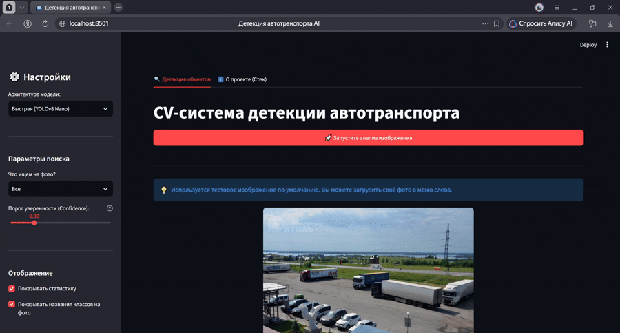

# Vehicle Detection AI (Microservice Architecture)




Проект представляет собой End-to-End систему компьютерного зрения для детекции и классификации автотранспорта. В основе лежат кастомные веса модели **YOLOv8**, дообученные на наборе данных **VisDrone**, оптимизированные для распознавания объектов с верхних ракурсов.

Проект построен по микросервисной архитектуре с полным разделением Backend (FastAPI) и Frontend (Streamlit) логики.

## Архитектура решения

1. **Backend API (FastAPI):**
   * Отвечает за инференс нейросети и геометрию (отрисовка Bounding Boxes).
   * **Оптимизация памяти:** Реализована ленивая загрузка весов. В оперативной памяти единовременно находится только одна активная модель. При смене архитектуры старая модель удаляется, а память принудительно очищается через Garbage Collector. Это предотвращает падение сервера от OOM (Out Of Memory) на маломощных хостингах.
   * Ограничение потоков PyTorch (`torch.set_num_threads(1)`) для защиты от CPU Thrashing.

2. **Frontend Dashboard (Streamlit):**
   * UI-панель для взаимодействия с API.
   * Интегрировано тестовое изображение по умолчанию. Сервис готов к демонстрации сразу после запуска без необходимости искать и загружать сторонние файлы.

3. **ML Pipeline (YOLOv8 + VisDrone):**
   * Доступны две версии весов: `Nano` (для быстрого инференса) и `Medium` (для высокой точности).
   * Оптимизатор из файлов весов вырезан (`strip_optimizer`), что уменьшило размер моделей в 2 раза для удобного деплоя.

## Ключевой функционал

* Выбор архитектуры на лету (Nano / Medium).
* Динамическая фильтрация классов (Легковые авто, Фургоны, Грузовики, Автобусы).
* Интерактивный тюнинг порога уверенности (Confidence Threshold).
* Сбор и агрегация статистики по найденным объектам (JSON).

## Запуск проекта локально

### Клонирование и установка зависимостей
```bash
git clone [https://github.com/egorsavitsky/vehicle-detection-api.git](https://github.com/egorsavitsky/vehicle-detection-api.git)
cd vehicle-detection-api
python -m venv venv
source venv/bin/activate  # Для Windows: venv\Scripts\activate
pip install -r requirements.txt
